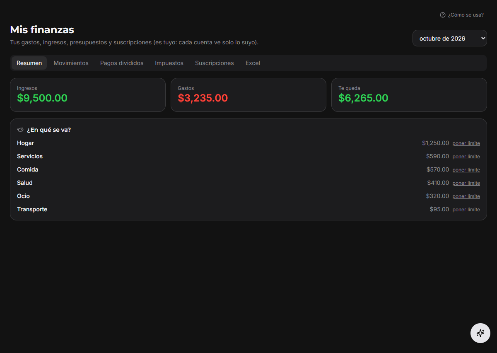
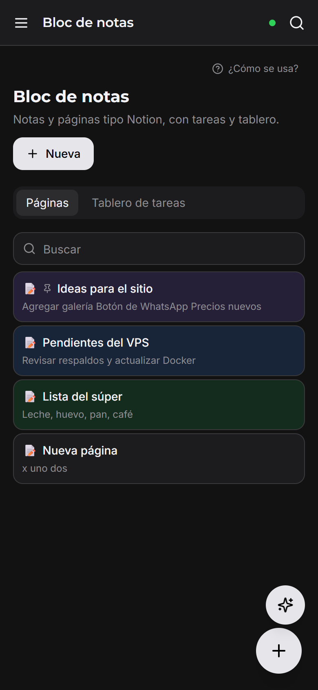
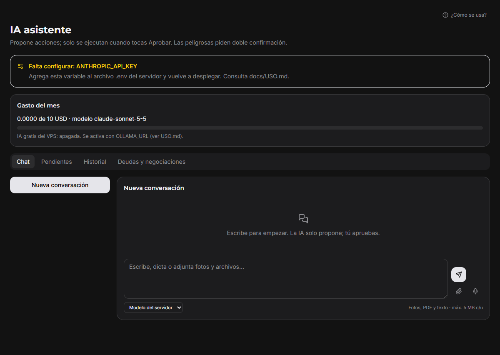
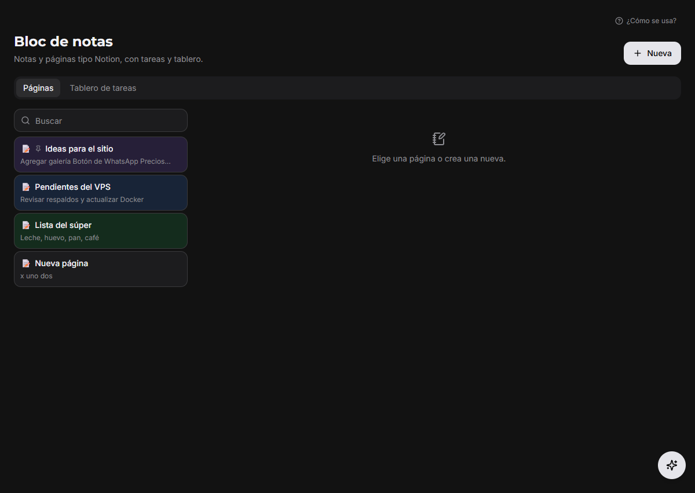
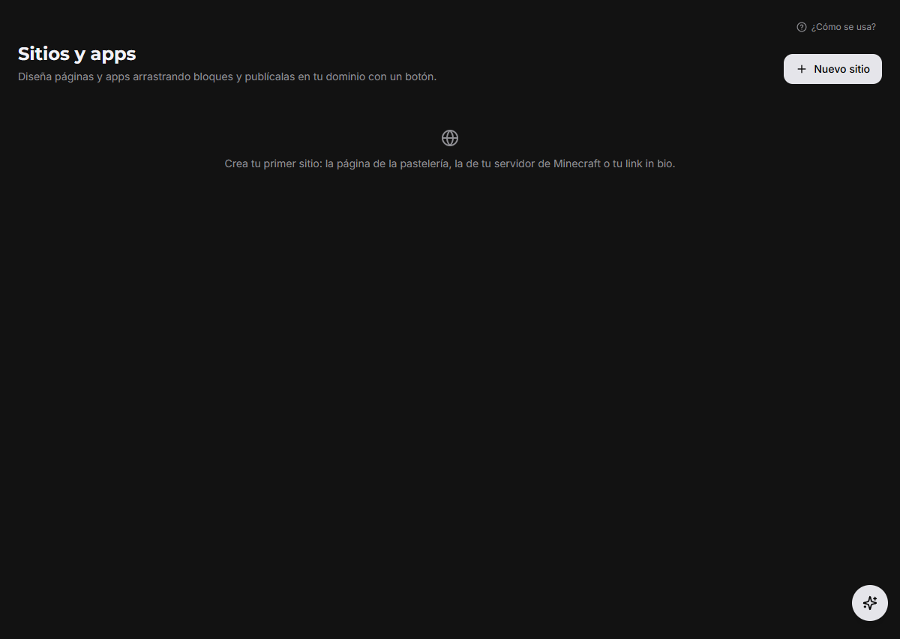
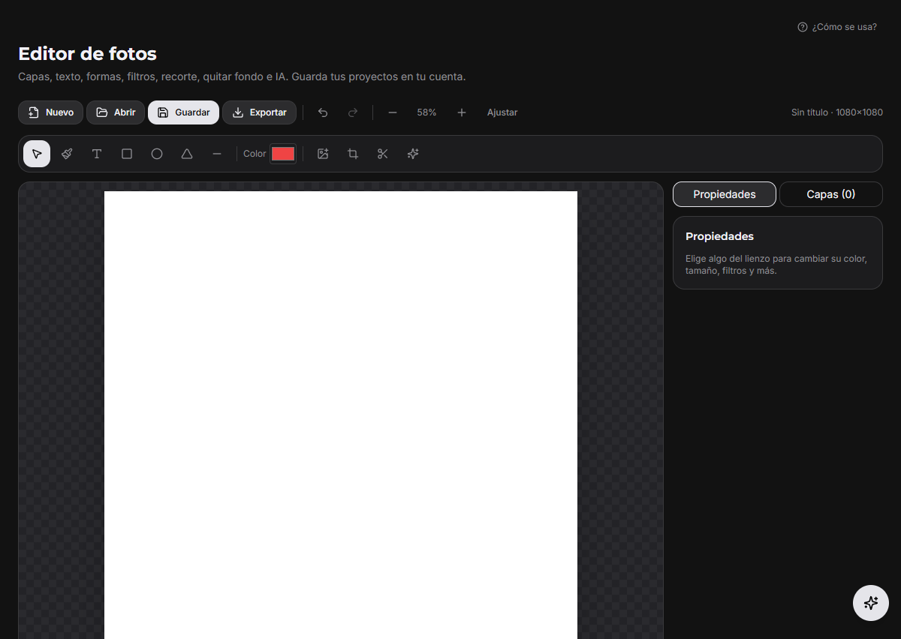
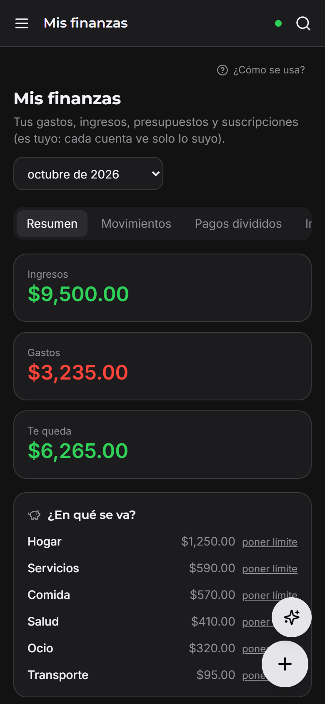

# Mi Setup

**Tu servidor, tus apps y tu día en un solo lugar.**

Mi Setup se instala en tu propio VPS y lo usas desde la **PC (Windows)**, el **celular (Android)** o el **navegador**: terminal, archivos, sitios web, finanzas, notas e IA. Tus datos se quedan contigo.

> Versión actual: **0.11.1** · Código abierto (MIT) · Guía completa en [`docs/USO.md`](docs/USO.md)

<p align="center">
  
  &nbsp;
  
</p>

> 🤖 **Hecho con inteligencia artificial.** El código de Mi Setup fue escrito con ayuda de IA (Claude). El autor no pide créditos por él. Este es el repositorio **oficial**: descarga solo desde aquí o desde la página oficial.

## Por qué Mi Setup

- 🔒 **Privado de verdad:** corre en tu VPS. Contraseñas cifradas, 2FA, huella y avisos de inicio de sesión.
- 📱 **PC, celular y web:** app de Windows, app de Android y navegador, todo sincronizado.
- 🤖 **IA que solo propone:** la IA te ayuda, pero nada se ejecuta en tu servidor hasta que tocas «Aprobar».
- 🧩 **Abierto:** licencia MIT. Mejóralo y compártelo.

## Funciones

Cada persona ve solo los apartados que le das en **Cuentas y permisos**.

| Apartado | Qué hace |
|---|---|
| 🖥️ **VPS** | Terminal, rendimiento, alertas de caída, comandos aprobados, archivos, seguridad y respaldos |
| 🌐 **Sitios y apps** | Editor visual, dominio propio, DNS automático en Cloudflare, pedidos, cuentas y estadísticas |
| 🤖 **IA asistente** | Claude, modelos gratis en tu VPS (Ollama) y agentes; solo propone, tú apruebas |
| 💰 **Mis finanzas** | Gastos con foto del ticket, suscripciones, pagos divididos, impuestos y rendimientos |
| 📝 **Notas y calendario** | Notas con fotos, voz y dictado, recordatorios, tareas y calendario |
| 🔐 **Contraseñas y 2FA** | Bóveda cifrada, códigos 2FA y autocompletado en Android |
| 🛡️ **Ciberseguridad** | Filtraciones de tu correo, correos peligrosos y avisos de inicio de sesión |
| 🎨 **Estudio** | Editor de fotos y video, convertidor, PDF, firma y códigos QR |
| 💬 **Chat** | Canales con fotos, archivos, código y notas de voz |

## Así se ve

| | |
|---|---|
|  |  |
| **IA asistente** | **Bloc de notas** |
|  |  |
| **Sitios y apps** | **Editor de fotos** |

<p align="center"></p>

*Capturas con datos de ejemplo.*

## Requisitos

Para tenerla encendida **24/7** necesitas un VPS. También puedes instalarla en tu PC, pero solo funciona mientras la PC esté prendida y conectada.

| | |
|---|---|
| **Mínimo** | 2 vCPU · 4 GB RAM · 40 GB de disco · Ubuntu 22.04/24.04 · Docker |
| **Recomendado** | 4 vCPU · 8 GB RAM · 100 GB de disco (para la IA gratis y los respaldos) |
| **Dominio** | Un dominio con DNS en Cloudflare (gratis) para el HTTPS y los sitios |

**Ejemplo real (VPS del autor):** Contabo · Ubuntu 22.04 · 96.7 GB de disco, con Mi Setup corriendo: **22.9 %** del disco y **14 %** de la memoria en uso.

## Descargas

En [Releases](https://github.com/dupeosserver-bit/Mi-setup/releases) están la versión nueva y las 2 anteriores:

- 🪟 **Windows:** `MiSetup-0.11.1.exe` (Windows 10/11)
- 🤖 **Android:** `MiSetup.apk` 0.11.1 (Android 8 o más nuevo)
- 🖥️ **Servidor:** este repositorio (Docker)

## Instalar tu propio Mi Setup

1. Renta un VPS (Contabo, Hetzner, DigitalOcean…) con Ubuntu y entra por SSH.
2. En Cloudflare apunta `setup.TUDOMINIO` y `*.TUDOMINIO` a la IP de tu VPS (nube gris).
3. Descarga el código:
   ```bash
   git clone https://github.com/dupeosserver-bit/Mi-setup.git /opt/mi-setup/app
   ```
4. Copia `.env.example` a `/opt/mi-setup/.env` y llena **tus** valores (`DOMAIN`, `APP_HOST` y contraseñas largas al azar para `POSTGRES_PASSWORD`, `JWT_SECRET` y `SERVER_ENC_KEY`).
5. Arranca:
   ```bash
   cd /opt/mi-setup/app && docker compose --env-file /opt/mi-setup/.env up -d --build
   ```
6. Crea la cuenta maestra con `deploy/instalar.sh` (o el comando de [`docs/USO.md`](docs/USO.md)) y activa el 2FA.
7. Las claves de servicios (IA, Google, Cloudflare…) se ponen desde la app: **Ajustes → Servicios y claves**.

Las apps de PC y celular se conectan a cualquier Mi Setup: en el inicio de sesión toca **Cambiar servidor** y escribe tu dirección.

## Seguridad

- Ningún secreto vive en el código: todo sale del `.env` o de Ajustes (cifrado con `SERVER_ENC_KEY`).
- Contraseñas y 2FA cifrados de extremo a extremo: el servidor nunca ve tus contraseñas.
- Permisos por apartado, confirmación con PIN, huella o contraseña para acciones delicadas, y registro de actividad que no se puede borrar.
- Si encuentras un problema de seguridad, avisa en privado antes de publicarlo.

## Comunidad

¿Hiciste tu propia versión de Mi Setup? Compártela y etiqueta a **[@JokeerYT_Oficia](https://x.com/JokeerYT_Oficia)** en X para verla.

- Reporta errores y propone ideas en [Issues](https://github.com/dupeosserver-bit/Mi-setup/issues).
- Manda tus mejoras con un pull request: lee [`CONTRIBUTING.md`](CONTRIBUTING.md).

## Para desarrolladores

```
apps/core/        Servidor (Fastify + Drizzle + PostgreSQL): API, tareas y seguridad
apps/ui/          Interfaz (React + Vite + Tailwind), la misma para web, PC y Android
apps/desktop/     App de Windows (Electron)
apps/mobile/      App de Android (Capacitor)
packages/shared/  Módulos, permisos, esquemas y cálculos compartidos
deploy/           Dockerfile, Caddyfile, instalador y respaldos del VPS
docs/             USO.md (cómo se usa e instala), SUPUESTOS.md (decisiones)
```

```bash
pnpm install
pnpm -r test
pnpm lint
```

## Licencia

[MIT](LICENSE): úsalo, cámbialo y compártelo libremente.
